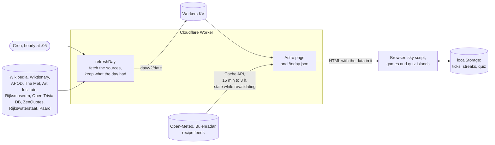

# duinlab-today

A small daily page at <https://today.duinlab.nl>: up to five pictures in a swipe strip, a few sourced facts, the
weather in The Hague, a three-question quiz and a short list of daily web
games with played-today marks and streaks. The sky at the top follows the sun's position over
The Hague, minute by minute. Checkmarks and streaks stay in your browser; the server keeps
nothing beyond Cloudflare's request logs.

## How it works



One Worker serves everything ([`src/worker.ts`](src/worker.ts)).

- **The day** (pictures, facts, featured article, word, quote, quiz, tides and
  events) is built by a cron run at five past every hour and stored in Workers KV, the same for every Cloudflare location. The run after
  midnight builds the new day. Later runs only touch a day that is incomplete: they retry a
  failed source and pick up APOD once it publishes at 06:00 Amsterdam time. A rebuild keeps
  every section the day already had, so the quiz never changes under you, and every picture it
  already has (each source picks its artwork from the date). A request that finds
  no day builds it itself ([`src/lib/today.ts`](src/lib/today.ts)).
- **Weather, sea and recipes** change during the day, so each request reads them through the
  Workers cache: 15 minutes for the weather, an hour for the sea, 3 hours for the recipes. An entry
  past that is still served while the request refreshes it in the background (`waitUntil`): for 2
  hours more for the weather, 6 for the sea and the recipes. Older than that, the request fetches it itself.
- **Planets and sky events** are worked out on the server with Astronomy Engine for each request:
  the planets tonight in the almanac, the sky events in the line under the date. The browser gets
  each planet's position for the day and works out altitude itself, like the moon and the bright star.
- **The page** is rendered on the server with all of this in it, so it reads fine without
  JavaScript. In the browser, a small inline script moves the sky with the clock, and two
  Svelte islands keep the games and the quiz in `localStorage`. Nothing goes back to the
  server.
- **`/today.json`** returns the same data for scripts (see [Data](#data)). Browsers and
  proxies may cache it for 5 minutes.

## Develop

You need Node 22 or later (CI uses 26). `packageManager` in `package.json` pins pnpm.

```sh
pnpm install
pnpm exec playwright install chromium
just dev
```

`just dev` starts the dev server in the background; `pnpm exec astro dev stop` ends it.
`just check` runs CI's lint, types, unit tests and build. `just e2e` runs the browser tests
against a production build, including an axe scan of the home, about and 404 pages. The Worker
reads every source from a local fixture server ([`e2e/fixture-server.mjs`](e2e/fixture-server.mjs))
through the `FIXTURE_ORIGIN` variable, so the tests run offline and give the same page every time.

For the NASA slide, put a line `NASA_API_KEY=<your key>` in `.dev.vars` for local runs. In
production it is a Worker secret (`pnpm wrangler secret put NASA_API_KEY`). Without a key the
strip simply has no NASA slide. The tests don't need it.

## Data

`/today.json` holds the same data as the page, for scripts such as an email digest. The
types in [`src/lib/types.ts`](src/lib/types.ts) describe every field. The top-level keys
are:

| Key | Type | When its source fails |
|---|---|---|
| `date` | the Amsterdam day, `YYYY-MM-DD` | always present |
| `generatedAt` | ISO instant (UTC) the day was built | always present |
| `sun`, `moon` | worked out locally | always present |
| `games` | the daily games | always present |
| `onThisDay`, `featured`, `word`, `quote`, `quiz`, `tides`, `events`, `weather`, `sea` | objects | `null` |
| `didYouKnow` | a list of facts | `[]` |
| `pictures` | up to five, in this order: APOD, The Met, Wikipedia picture of the day, Art Institute of Chicago, Rijksmuseum; one per source | `[]` |
| `recipes` | up to nine recipes (`title`, `url`, `source`), three per site | `[]` |

Sun times carry the Amsterdam offset. `weather.rainNext2h[].time` is `HH:MM` on the
Amsterdam clock, and `mm` is mm per hour: 5-minute steps from Buienradar's radar, or 15-minute
steps from Open-Meteo when Buienradar is down (`weather.rainCredit` says which). New fields may
appear at any time. A commit that renames or removes a field says so in its message.
When every source fails, the endpoint still answers 200, with a short cache time. When the
Worker itself fails, it answers 503 with `{"error": ...}`.

## Sources

Wikipedia (On this day, Did you know, the featured article), Wiktionary (word of the day),
NASA APOD, The Metropolitan Museum of Art, the Art Institute of Chicago and the Rijksmuseum (public-domain works), the Wikipedia picture of the day (credited with its licence), Open Trivia DB (CC BY-SA 4.0),
ZenQuotes, Rijkswaterstaat (tide times at Scheveningen), Paard, Amare and DenHaag.com (this week's shows and events; the last two through a weekly homelab job that writes `agenda/v1` to KV), Open-Meteo (weather, air quality, pollen and the sea off Scheveningen), Buienradar (the rain radar),
Astronomy Engine (planets, full moons, eclipses; an npm package, not a feed), and the
recipe feeds of the Guardian, BBC Good Food and
Love and Lemons. Each item on the page links to its source.

## Licence

MIT, see [LICENSE](LICENSE). Content from the sources keeps its own licence.
