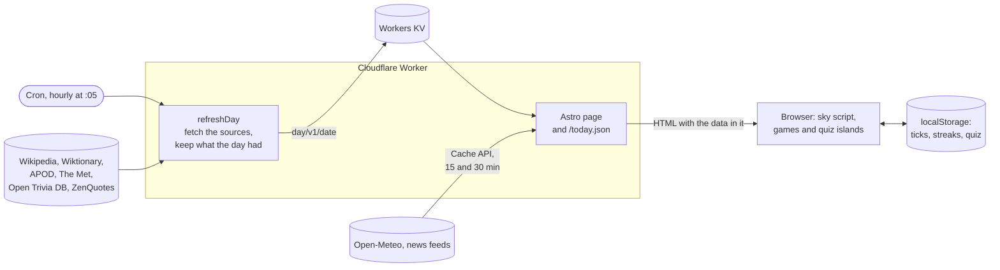

# duinlab-today

A small daily page at <https://today.duinlab.nl>: the day's picture, a few sourced facts, the
weather in The Hague, a five-question quiz, five headlines and a short list of daily web
games with played-today marks and streaks. The sky at the top follows the sun's position over
The Hague, minute by minute. Checkmarks and streaks stay in your browser; the server keeps
nothing beyond Cloudflare's request logs.

## How it works



One Worker serves everything ([`src/worker.ts`](src/worker.ts)).

- **The day** (picture, facts, word, quote, quiz) is built by a cron run at five past every
  hour and stored in Workers KV, the same for every Cloudflare location. The run after
  midnight builds the new day. Later runs only touch a day that is incomplete: they retry a
  failed source and pick up APOD once it publishes at 06:00 Amsterdam time. A rebuild keeps
  every section the day already had, so the quiz never changes under you. A request that finds
  no day builds it itself ([`src/lib/today.ts`](src/lib/today.ts)).
- **Weather and headlines** change during the day, so each request reads them through the
  Workers cache: 15 minutes for the weather, 30 for the news.
- **The page** is rendered on the server with all of this in it, so it reads fine without
  JavaScript. In the browser, a small inline script moves the sky with the clock, and two
  Svelte islands keep the games and the quiz in `localStorage`. Nothing goes back to the
  server.
- **`/today.json`** returns the same data for scripts (see [Data](#data)). Browsers and
  proxies may cache it for 5 minutes.

## Develop

You need Node 22 or later (CI uses 26). `packageManager` in `package.json` pins pnpm.

```sh
pnpm install
pnpm exec playwright install chromium
just dev
```

`just dev` starts the dev server in the background; `pnpm exec astro dev stop` ends it.
`just check` runs CI's lint, types, unit tests and build. `just e2e` runs the browser tests
against a production build, including an axe scan of the home, about and 404 pages.

For the NASA picture, put a line `NASA_API_KEY=<your key>` in `.dev.vars` for local runs. In
production it is a Worker secret (`pnpm wrangler secret put NASA_API_KEY`). Without a key the
picture comes from The Met. The tests don't need it.

## Data

`/today.json` holds the same data as the page, for scripts such as an email digest. The
types in [`src/lib/types.ts`](src/lib/types.ts) describe every field. The top-level keys
are:

| Key | Type | When its source fails |
|---|---|---|
| `date` | the Amsterdam day, `YYYY-MM-DD` | always present |
| `generatedAt` | ISO instant (UTC) the day was built | always present |
| `sun`, `moon` | worked out locally | always present |
| `games` | the daily games | always present |
| `picture`, `onThisDay`, `word`, `quote`, `quiz`, `weather` | objects | `null` |
| `didYouKnow` | a list of facts | `[]` |
| `news` | up to five headlines, one per paper | `[]` |

Sun times carry the Amsterdam offset. `weather.rainNext2h[].time` is `HH:MM` on the
Amsterdam clock. New fields may appear at any time. A commit that renames or removes a field says so
in its message.
When every source fails, the endpoint still answers 200, with a short cache time. When the
Worker itself fails, it answers 503 with `{"error": ...}`.

## Sources

Wikipedia (On this day, Did you know), Wiktionary (word of the day), NASA APOD, The
Metropolitan Museum of Art (public-domain works), Open Trivia DB (CC BY-SA 4.0), ZenQuotes,
Open-Meteo, and the front-page RSS feeds of NOS, NRC, the BBC, the Guardian and the New York
Times. Each item on the page links to its source.

## Licence

MIT, see [LICENSE](LICENSE). Content from the sources keeps its own licence.
