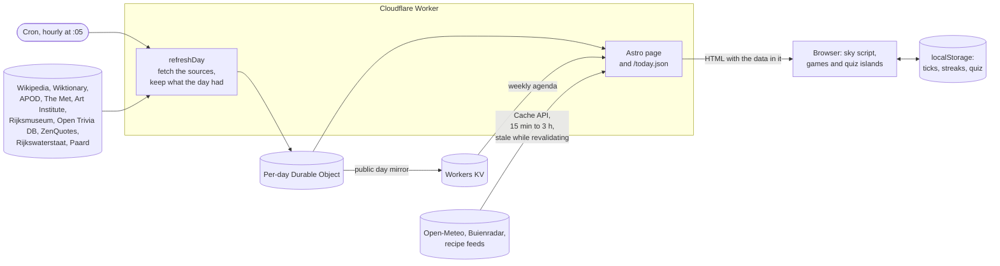

# duinlab-today

[Today's paper](https://today.duinlab.nl) brings together pictures, sourced facts, weather in
The Hague, a three-question quiz and daily web games. The sky follows the real sun, minute by minute.
Opening a game marks it as played. Marks and streaks stay in your browser.

Tap a picture to enlarge it, zoom in or browse the day's images. Captions and source links stay in view.
The viewer uses the original image when available and the preview if it fails. "Open original"
opens the image directly. NASA pictures include an "About this picture" explanation when the source
supplies one; it starts collapsed and works without JavaScript. Without JavaScript, pictures link
directly to their images.

Tap the sun, moon, a planet or the bright star to open the almanac: sun and moon times, planets, tides and sea
conditions. It opens the selected object's details first; without JavaScript, it shows the full overview.
Moonrise and moonset follow the configured local day; the almanac says when either does not occur that day.
After the quiz, open "Review answers" to revisit your choices. Answers sync across tabs in the same
browser; the first saved answer is kept.

## Make your own version

Edit [`site.toml`](site.toml), or start from the [Utrecht](examples/utrecht.toml) or
[Evanston, Illinois](examples/evanston.toml) example. The configuration covers the location,
time zone, units, picture sources and daily games. Unsupported local sections are omitted.
See [configuration and fork deployment](docs/configuration.md) before deploying to your own Cloudflare account.

## How it works



One Worker serves everything ([`src/worker.ts`](src/worker.ts)).

- **The day** (pictures, facts, featured article, word, quote, quiz, tides and events) is built at
  five past every hour. A per-day Durable Object stores one shared copy, mirrored in Workers KV.
  Both retain two days in the configured time zone. Later runs retry incomplete days and keep
  existing content, so the quiz and pictures stay the same. Each artwork source picks by date.
  A request with no stored day builds it through the same coordinator
  ([`src/lib/today.ts`](src/lib/today.ts)). An incomplete day is served while missing sources retry in the background.
- **Weather, sea and recipes** change during the day, so each request reads them through the
  Workers cache: 15 minutes for the weather, an hour for the sea, 3 hours for the recipes. An entry
  past that is still served while the request refreshes it in the background (`waitUntil`): for 2
  hours more for the weather, 6 for the sea and the recipes. Older than that, the request fetches it itself.
- **Planets and sky events** are worked out on the server with Astronomy Engine for each request:
  the planets tonight in the almanac, the sky events in the line under the date. The browser gets
  each planet's position for the day and works out altitude itself, like the moon and the bright star.
- **The page** is rendered on the server and reads in full without JavaScript. A browser script
  moves the sky with the clock. Svelte components save game and quiz progress in `localStorage`;
  progress never goes to the server. Cloudflare keeps request logs.
- **`/today.json`** returns the same data for scripts (see [Data](#data)). Browsers and
  proxies may cache it for 5 minutes.

## Development

Install Node 22.23.4 or later (CI uses 26), [pnpm](https://pnpm.io/installation) and
[just](https://just.systems/man/en/packages.html). Use the pnpm version pinned by
`packageManager` in `package.json`.

```sh
pnpm install
just check
```

`just check` runs CI's lint, types, unit tests, build, licence check and production dependency audit.
Checks and builds generate Cloudflare runtime and binding types from `wrangler.jsonc`.
`just hooks` runs the git hooks over the whole repo.

`just dev` starts the dev server in the background. Use `pnpm exec astro dev status` to check it,
`pnpm exec astro dev logs` to read its output and `pnpm exec astro dev stop` to end it.

`just e2e` runs the browser tests against a production build, after a one-time
`pnpm exec playwright install chromium`. They include axe scans of today, yesterday, about and 404 pages and
a print-layout check. It runs the default suite and a separate APOD suite with a fixture key; no real NASA key
is required. The Worker reads every source from a local fixture server
([`e2e/fixture-server.mjs`](e2e/fixture-server.mjs)) through the `FIXTURE_ORIGIN` variable, so the tests run
offline with repeatable content.
See [release preparation](docs/releasing.md) before a deployment or release tag.

The social card `public/og.png` is rendered from `docs/og-card.html`. Keep its text inside the centred 630 px
column, because some link previews crop to it. After editing, run `just og-card`.

For the NASA slide, put a line `NASA_API_KEY=<your key>` in `.dev.vars` for local runs. In
production it is a Worker secret (`pnpm wrangler secret put NASA_API_KEY`). Without a key the
strip has no NASA slide. The tests don't need it.

NASA leads the picture strip when available. If its API returns a placeholder or fails, the
Worker reads the same day's image, credit and description from NASA's official APOD feed.

## Data

`/today.json` holds the same data as the page, for scripts such as an email digest. The
types in [`src/lib/types.ts`](src/lib/types.ts) describe every field. The top-level keys
are:

| Key | Type | When its source fails |
|---|---|---|
| `date` | the configured local day, `YYYY-MM-DD` | always present |
| `generatedAt` | ISO instant (UTC) the day was built | always present |
| `sun`, `moon` | worked out locally | always present |
| `games` | the daily games | always present |
| `onThisDay`, `featured`, `word`, `quote`, `quiz`, `tides`, `events`, `weather`, `sea` | objects | `null` |
| `didYouKnow` | a list of facts | `[]` |
| `pictures` | up to five enabled sources, in configured order; one per source | `[]` |
| `recipes` | up to nine recipes (`title`, `url`, `source`), three per site | `[]` |

Pictures may include an optional `explanation` from the source. Older stored days can omit it.
Moonrise and moonset are calculated on the server for the page; the JSON `moon` fields are unchanged.

Sun times carry the configured time zone’s offset. `weather.rainNext2h[].time` is `HH:MM` on the
local clock, and `mm` is mm per hour: 5-minute steps from KNMI's radar nowcast (`rain/v1` in KV)
or Buienradar's radar, or 15-minute steps from Open-Meteo when both are unavailable (`weather.rainCredit` says which).
The JSON API keeps metric weather values (including Celsius and km/h) regardless of display units.
Disabled tides, events and sea sections return `null`.
Elapsed intervals are removed on each request, so the remaining forecast can cover less than two hours.
An empty list means no usable rain forecast. New fields may
appear at any time. A commit that renames or removes a field says so in its message.
When every source fails, the endpoint still answers 200, with a short cache time. When the
Worker itself fails, it answers 503 with `{"error": ...}`.

## Sources

Wikipedia (On this day, Did you know, the featured article), Wiktionary (word of the day),
NASA APOD, The Metropolitan Museum of Art, the Art Institute of Chicago and the Rijksmuseum (public-domain works), the Wikipedia picture of the day (credited with its licence), Open Trivia DB (CC BY-SA 4.0),
ZenQuotes, Rijkswaterstaat (tide times at Scheveningen), Paard, Amare and DenHaag.com (this week's shows and events; the last two through a weekly homelab job that writes `agenda/v1` to KV), Open-Meteo (weather, air quality, pollen and the sea off Scheveningen), KNMI (`radar_forecast/2.0` via a scheduled homelab job that writes `rain/v1` to KV) and Buienradar (fallback rain radar),
Astronomy Engine (planets, full moons, eclipses; an npm package, not a feed), and the
recipe feeds of the Guardian, BBC Good Food and
Love and Lemons. Each item on the page links to its source.

## Privacy and accessibility

The [privacy statement](docs/privacy.md) says what the site keeps and which sites your browser contacts. The [accessibility statement](docs/accessibility.md) says what is checked and what is known to fail.

## Licence

MIT, see [LICENSE](LICENSE). Content from the sources keeps its own licence.
